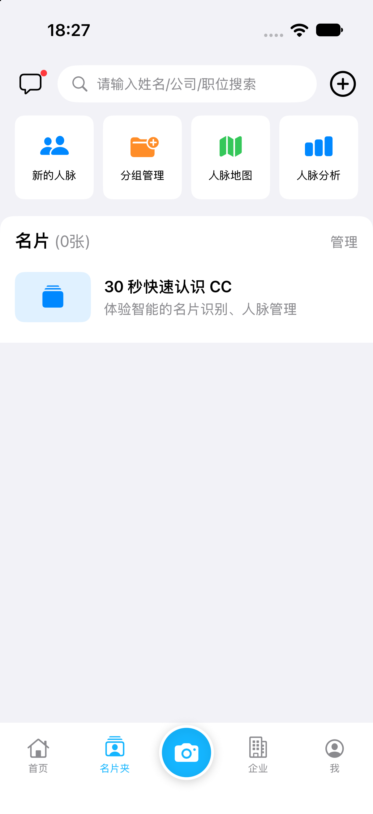
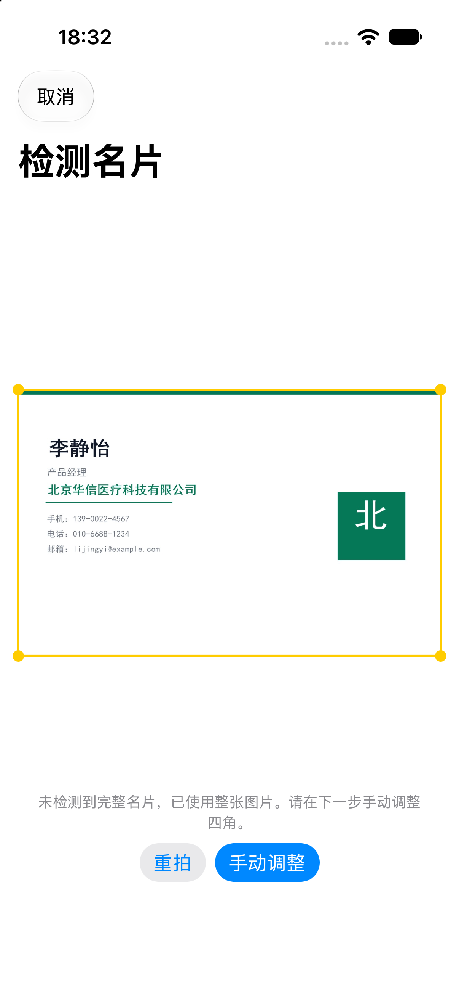
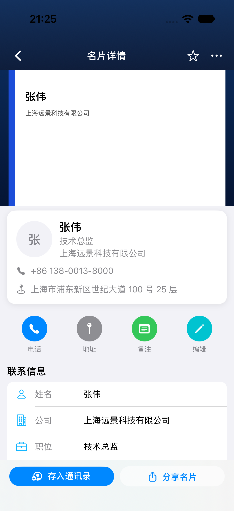

# 名片数字化与联系人管理项目报告

- 学号：2454284
- 姓名：梁皓诚
- 项目名称：CamCardClone
- 开发工具：Xcode 27.2
- 开发语言：Swift
- 界面框架：SwiftUI
- 开发环境：iOS 27.2 SDK
- 部署目标：iOS 17.0

## 摘要

我实现了一套面向 iPhone 的名片数字化与联系人管理应用。用户可以通过相机拍摄或相册导入名片，应用自动完成名片区域检测、透视校正、文字识别、联系人字段整理和本地保存。保存后的名片可以搜索、分组、查看详情、编辑图片、维护正反面照片，并导出到系统联系人或 VCF 文件。

我重点处理了三个实际问题：第一，将拍摄、校正、识别和保存串成连续流程，减少用户手动操作；第二，针对倾斜拍摄、桌面背景和混合语言名片增加检测与识别补偿；第三，将名片图片和联系人字段分别保存，使图片删除、重新裁切和字段编辑互不影响。

## 一、项目背景与目标

纸质名片包含姓名、公司、职位、电话、邮箱和地址等信息。手动录入速度慢，也容易遗漏。我希望实现一套完整、清晰且可离线使用的名片管理流程：

- 用手机快速采集名片。
- 自动找出名片边界并校正倾斜角度。
- 提取名片上的联系人信息。
- 允许保存前人工修改。
- 将名片长期保存在本地，并支持后续检索、分组和导出。

我把实际可操作性作为首要目标。界面上的入口、返回、取消、保存、编辑、删除和提示均有完整状态处理，不采用只展示页面的静态原型。

## 二、功能范围

### 1. 名片采集

扫描页提供相机拍摄和相册导入两种入口。相机页包含取景框、识别模式、闪光灯、相册入口、取消和拍摄按钮。取景框比例与名片接近，拍摄后会先按取景区域预裁切，再进入自动检测。

### 2. 名片检测与图像校正

名片区域检测使用 Vision 的矩形检测，同时增加亮度与颜色区域分析。面对“显示器里显示名片”或“名片放在笔记本屏幕上”的情况，算法会优先选择内部较亮、比例接近名片的矩形，减少把整个屏幕边框识别成名片的情况。

确认四角后，使用 Core Image 的透视校正生成正视名片图。用户也可以在自动检测不可靠时手动调整四角、旋转方向和重新拍摄。

### 3. 文字识别与字段整理

文字识别使用 Vision 本地能力，语言包括简体中文、繁体中文和英文。为提高复杂照片的识别效果，流程中加入了以下处理：

- 对名片图片进行灰度化、对比度和锐化增强。
- 对较小的名片图片使用 Lanczos 放大后再识别。
- 增加英文辅助识别，修正中英文混排名片中的邮箱和英文公司名。
- 根据文字坐标恢复从上到下、从左到右的阅读顺序。
- 过滤桌面工具栏、识别模式文字、日期等非联系人内容。
- 使用标签、行首特征、正则表达式和版式位置整理联系人字段。

如果自动裁切区域的文字过少，系统会谨慎使用整张原图进行补充识别；只有原图结果明显更完整时才采用，避免把桌面信息写入联系人。

### 4. 人工校对与保存

识别完成后直接进入字段编辑页。页面顶部显示处理后的名片，下面列出姓名、公司、职位、部门、手机、电话、传真、邮箱、网址、地址、邮编和备注。用户可以修改识别结果，也可以补充多个电话和邮箱。

保存时同时写入结构化数据和图片文件。应用退出或重启后，名片仍可恢复。

### 5. 名片夹与搜索

首页按姓名拼音首字母分组，右侧字母索引会随分组数量生成。点击字母可以跳转到对应分组。没有正面图片时，列表使用姓名首字作为缩略图。搜索支持姓名、公司、职位、电话、邮箱、地址、备注和分组名称。

### 6. 分组管理

分组管理支持新建、搜索、重命名、排序和编辑状态下的删除。进入某个分组后，可以添加名片、多选名片、批量删除名片，也可以打开名片的管理菜单，将名片加入或移出当前分组。

删除分组和删除名片是两个独立操作。删除分组不会删除联系人；删除名片会从名片夹中移除该联系人。

### 7. 名片详情与图片处理

详情页顶部使用蓝色背景承载名片图片。向下滚动时，图片逐渐缩小并淡出，导航区域平滑并入顶部。页面上只保留一个返回按钮。

详情页支持正面和背面照片。点击照片可进行重新拍摄、从相册替换、旋转、删除和手动裁切。照片与联系人字段独立保存，删除照片不会删除姓名、电话等信息。背面照片只进行校正和处理，不进入文字识别。

### 8. 联系人导出

详情页可将名片写入系统通讯录，也可以生成 VCF 文件。导出时只映射名片中实际存在的字段，多电话和多邮箱会一并写入。

## 三、界面设计

应用采用浅色界面和明亮天蓝色作为主要强调色。首页、分组、搜索、详情和识别结果使用统一的字体层级、圆角、间距和按钮样式。

主要界面如下：








拍摄页使用深色背景，使取景框和名片内容更突出；识别、编辑和管理页面使用浅色背景，便于阅读。所有弹窗菜单从底部出现，破坏性操作使用红色文字，与普通操作保持区分。

## 四、技术实现

### 开发技术

| 能力 | 技术 |
|---|---|
| 界面 | SwiftUI |
| 页面状态 | Observation、MVVM |
| 导航 | NavigationStack |
| 相机 | AVFoundation |
| 相册 | PhotosPicker、Photos |
| 图像处理 | Core Image、ImageIO |
| 名片检测 | Vision VNDetectRectanglesRequest |
| 文字识别 | Vision VNRecognizeTextRequest |
| 数据存储 | FileManager、Codable、JSON |
| 联系人导出 | Contacts、CNContactVCardSerialization |
| 测试 | XCTest、XCUITest |

### 关键处理策略

1. 图片解码和检测执行放在后台线程，避免主线程长时间阻塞。
2. 拍摄后按取景框预裁切，减少框外背景对检测的影响。
3. 检测阶段同时评估矩形结果和内部高亮区域，兼顾普通桌面与屏幕显示场景。
4. 识别阶段先使用裁切图，不满足要求时再尝试不同方向和原图补充。
5. 字段解析保留识别原文，缺少的信息保持为空，不自行补全。
6. 图片与联系人数据分开存储，任何一方修改都不破坏另一方。

## 五、数据与持久化

应用数据保存在沙盒 `Documents` 目录：

- `Documents/businesscards.json`：保存名片字段、分组和版本信息。
- `Documents/Images/`：保存正面原图、处理图和背面图。

JSON 使用原子写入，避免应用中断时产生半写入文件。图片只保存文件名，不保存设备绝对路径，便于后续迁移。

名片主要字段包括：

```text
id
originalImageFileName
processedImageFileName
backImageFileName
name / company / jobTitle / department
mobile / phone / fax / email / website
address / postalCode / notes
tags / additionalPhones / additionalEmails
createdAt / updatedAt / ocrRawText
```

## 六、测试情况

我同时编写了单元测试和界面测试，覆盖坐标换算、矩形选择、字段解析、持久化、图片存储、联系人导出、首页、扫描入口、识别导入、详情、编辑、搜索、分组、删除和重启恢复等流程。

当前 42 张测试名片包含中文、英文、中英双语、复杂背景、多电话、多邮箱、字段缺失、倾斜拍摄和竖版版式。字段解析器在标准答案文本上的回归结果为 12 个字段全部匹配，没有凭空生成字段。

应用源码已经通过 iOS 无签名构建。更详细的测试环境和结果见 `测试报告.md`。

## 七、不足与后续改进

1. 复杂光线下文字识别仍可能出错，当前通过高对比度处理、多方向尝试和人工校对降低影响。
2. 背景中存在多个白色矩形时，自动检测仍可能需要用户手动确认四角。
3. 当前只保存本机数据，不包含账号登录、云同步和多设备同步。
4. 分享名片、人脉地图、人脉分析和好友更新记录只保留入口提示。
5. 联系人文中某些特殊格式仍需在导出前人工检查。

## 八、总结

我完成了从名片采集、图像校正、文字识别、字段校对、保存管理到联系人导出的完整闭环。开发过程中，我不仅完成了主要页面，还针对拍摄卡顿、边界误判、图片比例、字段串位、正反面独立管理、分组操作和详情页交互等问题进行了持续调整。

应用结构清晰、可以独立编译运行，测试素材和标准答案齐全。
